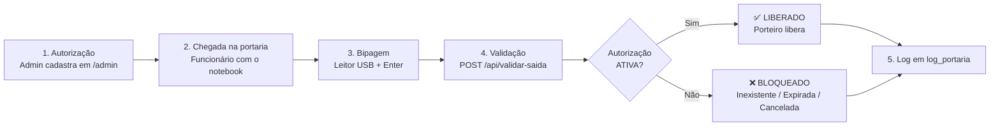

# Layout Visual — Sistema de Controle de Saída de Notebooks (Portaria)

Os PNGs desta pasta (`01` a `06`) são mockups de referência em 1280x720. Abaixo, a especificação completa para reproduzir em Figma, Canva ou apresentação.

---

## 1. Paleta de cores final

| Função | Cor | Hex | Uso |
|---|---|---|---|
| Primária | Azul | `#1D4ED8` | Navbar admin, botão Salvar, links |
| Primária (hover) | Azul escuro | `#1E40AF` | Hover de botões |
| Sucesso (LIBERADO) | Verde | `#16A34A` | Fundo da tela liberado, badge ATIVA |
| Sucesso (piscada) | Verde claro | `#22C55E` | Animação do flash |
| Sucesso (painel) | Verde escuro | `#0F7A37` | Card de dados sobre fundo verde |
| Erro (BLOQUEADO) | Vermelho | `#DC2626` | Fundo da tela bloqueado, badge CANCELADA |
| Erro (piscada) | Vermelho escuro | `#991B1B` | Animação do flash |
| Alerta | Amarelo | `#FACC15` | Botão "Limpar logs", avisos |
| Info / foco | Azul claro | `#38BDF8` | Borda do campo de leitura, indicador pulsante |
| Fundo portaria | Azul-marinho | `#0F172A` | Tela de espera |
| Fundo rodapé | Azul quase preto | `#0B1220` | Topo e rodapé da portaria |
| Cartão neutro | Cinza-azulado | `#334155` | Itens das últimas leituras |
| Fundo admin | Cinza claro | `#F1F5F9` | Fundo da página admin |
| Borda | Cinza | `#CBD5E1` | Bordas de campos |
| Texto principal | Quase preto | `#0F172A` | Texto no admin |
| Texto claro | Branco gelo | `#F8FAFC` | Texto na portaria |
| Texto secundário | Cinza | `#94A3B8` | Subtítulos, placeholders |
| Expirada | Cinza | `#6B7280` | Badge EXPIRADA |

Contraste: branco sobre `#16A34A` e `#DC2626` fica acima de 4,5:1 em texto grande (títulos de 80px+), atendendo o uso a 2 m de distância.

---

## 2. Tipografia

- **Família:** `Segoe UI`, `Roboto`, `Arial`, sans-serif (fontes de sistema, sem download). No Figma/Canva use **Inter** ou **Roboto**.
- **Portaria (legível a 2 metros):**
  - Veredito (LIBERADO/BLOQUEADO): 128px (mín. 56px), peso 900
  - Chamada "BIPE A PLAQUETA...": 72px (mín. 36px), peso 800
  - Dados do funcionário: 35px (mín. 21px), peso 600/700
  - Campo de leitura: 38px, peso 700, espaçamento de letras 2px
  - Últimas leituras: 17-19px
  - Contador regressivo: 32px
- **Admin:** corpo 16px, rótulos 14px, cabeçalho de tabela 13px MAIÚSCULAS, títulos de card 20px.
- **Espaçamentos:** grade de 8px; padding de tela 32px; cards com raio 14-20px; gap entre itens 10px.

---

## 3. Telas (ASCII)

### 3.1 Portaria — Aguardando leitura (`01-tela-portaria-aguardando.png`)

```
┌──────────────────────────────────────────────────────────────────────────┐
│ 💻 CONTROLE DE SAÍDA DE NOTEBOOKS            quarta-feira, 14/10 10:32:08 │ ← topo #0B1220
├──────────────────────────────────────────────────────────────────────────┤
│                                                                          │
│                              ( ))) ◉ (((                                 │ ← círculo azul #38BDF8
│                              (  ▌▌▌▌▌  )                                 │   pulsando (ondas)
│                                                                          │
│                  BIPE A PLAQUETA PARA LIBERAR                            │ ← 72px, branco
│          Aponte o leitor para o código de barras do notebook             │ ← 28px, #94A3B8
│                                                                          │
│              ┌──────────────────────────────────────┐                    │
│              │        Código da plaqueta            │                    │ ← campo 38px, foco permanente
│              └──────────────────────────────────────┘                    │
│                                                                          │
├──────────────────────────────────────────────────────────────────────────┤
│ ÚLTIMAS 5 LEITURAS                                                       │
│ ▌NB00123 ✅  ▌NB99999 ❌  ▌NB00124 ✅  ▌NB00125 ❌  ▌NB00123 ✅           │
└──────────────────────────────────────────────────────────────────────────┘
```
**Hierarquia:** 1) texto "BIPE A PLAQUETA" e indicador pulsante; 2) campo de leitura; 3) histórico.

### 3.2 Portaria — LIBERADO (`02-tela-portaria-liberado.png`)

```
┌──────────────────────────────────────────────────────────────────────────┐
│ CONTROLE DE SAÍDA DE NOTEBOOKS                              data/hora    │
│                                                         ( ⏳ 5s )        │ ← contador
│                               (  ✔  )                                    │ ← ícone 192px branco
│                          ✅ LIBERADO                                     │ ← 128px, peso 900
│         ┌──────────────────────────────────────────────────┐             │
│         │ Plaqueta:        NB00123                         │             │ ← card #0F7A37
│         │ Funcionário:     João Silva (mat. 12345)         │             │
│         │ Autorizado por:  Maria Santos                    │             │
│         │ Válido até:      31/12/2026 18:00                │             │
│         └──────────────────────────────────────────────────┘             │
│            Pode liberar a saída do equipamento.                          │
│              [ campo de leitura continua ativo ]                         │
│ ÚLTIMAS 5 LEITURAS ...                                                   │
└──────────────────────────────────────────────────────────────────────────┘
```
Fundo `#16A34A` com flash para `#22C55E` (2 ciclos de 0,9s) + beep agudo curto (880 Hz, 0,2s).

### 3.3 Portaria — BLOQUEADO (`03-tela-portaria-bloqueado.png`)

```
┌──────────────────────────────────────────────────────────────────────────┐
│ CONTROLE DE SAÍDA DE NOTEBOOKS                              data/hora    │
│                                                         ( ⏳ 5s )        │
│                               (  ✖  )                                    │
│                          ❌ BLOQUEADO                                    │
│                      Autorização expirada                                │ ← motivo, 48px
│              ┌─────────────────────────────────┐                         │
│              │ Código lido:  NB00125           │                         │
│              └─────────────────────────────────┘                         │
│   NÃO libere. Retenha o equipamento e acione o responsável.              │ ← instrução ao porteiro
│              [ campo de leitura continua ativo ]                         │
│ ÚLTIMAS 5 LEITURAS ...                                                   │
└──────────────────────────────────────────────────────────────────────────┘
```
Fundo `#DC2626` piscando rápido para `#991B1B` (4 ciclos de 0,5s) + beep grave longo (220 Hz, onda quadrada, 0,7s).
Motivos exibidos: "Bem não cadastrado", "Autorização expirada", "Autorização cancelada", "Erro de comunicação com o servidor".

### 3.4 Admin — Formulário (`04-tela-admin-formulario.png`)

```
┌──────────────────────────────────────────────────────────────────────────┐
│ 💻 Autorizações de Saída        [Abrir Portaria][Limpar logs][Limpar TUDO]│ ← navbar #1D4ED8
├──────────────────────────────────────────────────────────────────────────┤
│  ┌────────────────────────────────────────────────────────────────────┐  │
│  │ ➕ Nova autorização                                                │  │
│  │ Código da plaqueta *   Nome do funcionário *    Matrícula *        │  │
│  │ [🔲 NB00123       ]    [ João Silva        ]    [ 12345     ]      │  │
│  │ Autorizado por *       Validade (opcional)                         │  │
│  │ [ Maria Santos    ]    [ 31/12/2026 18:00  ]    [💾 SALVAR]        │  │
│  └────────────────────────────────────────────────────────────────────┘  │
│  Campo inválido → borda vermelha + mensagem. Sucesso → alerta verde.     │
└──────────────────────────────────────────────────────────────────────────┘
```

### 3.5 Admin — Lista (`05-tela-admin-lista.png`)

```
┌──────────────────────────────────────────────────────────────────────────┐
│ Autorizações cadastradas        [🔍 Buscar...      ] [Todos status ▾]    │
├─────────┬──────────┬─────────────┬─────────┬───────────────┬─────────────┤
│ STATUS  │ PLAQUETA │ FUNCIONÁRIO │ MATRÍC. │ AUTORIZADO POR│ VALIDADE/AÇÃO│
├─────────┼──────────┼─────────────┼─────────┼───────────────┼─────────────┤
│ 🟢ATIVA │ NB00123  │ João Silva  │ 12345   │ Maria Santos  │ 31/12 [Cancelar]│
│ 🟢ATIVA │ NB00124  │ Ana Souza   │ 23456   │ Carlos Lima   │ sem validade [Cancelar]│
│ ⚪EXPIRADA│ NB00125 │ Pedro Alves │ 34567   │ Maria Santos  │ 12/10/2026  │
│ 🔴CANCEL.│ NB00126  │ Luiza Costa │ 45678   │ Carlos Lima   │ (linha opaca)│
└─────────┴──────────┴─────────────┴─────────┴───────────────┴─────────────┘
```
Badges: verde `#16A34A` (ativa), cinza `#6B7280` (expirada), vermelho `#DC2626` (cancelada). Botão Cancelar só aparece em ATIVA.

---

## 4. Especificação de UI/UX

**Componentes:** campo de leitura (input grande), botões (primário azul, perigo vermelho, alerta amarelo), cards (raio 14px, sombra suave), tabela responsiva Bootstrap, badges de status, alertas dispensáveis, `confirm()` nativo para ações destrutivas.

**Comportamentos:**
- Foco: campo da portaria com borda `#38BDF8` e anel de 6px; refocus automático a cada 700ms, ao clicar em qualquer ponto e ao perder foco.
- Hover: botões escurecem; linhas da tabela destacam.
- Animações: pulso do indicador (1,6s, infinito); flash verde (0,9s x2) e vermelho (0,5s x4); transição de fundo 0,25s.
- Contador regressivo 5→0, depois volta ao estado inicial. Nova leitura durante o resultado substitui o resultado imediatamente.
- Campo limpo automaticamente após cada Enter.

**Responsividade:** portaria usa `clamp()` e unidades vw, ocupando 100% da tela (monitor 24"+ em 1920x1080 ideal, também funciona em notebook). Admin usa grade Bootstrap: 3 colunas em tela larga, 1 coluna em telas pequenas; tabela com rolagem horizontal.

**Acessibilidade:** alto contraste, ícone + texto + cor (não depende só de cor), rótulos `aria-label`, feedback sonoro opcional (Web Audio, sem arquivos), fonte grande, instrução explícita ao porteiro.

---

## 5. Ícones (Font Awesome 6 Free — já carregado via CDN)

| Ação | Ícone | Onde usar |
|---|---|---|
| Liberado | `fa-circle-check` | Tela LIBERADO |
| Bloqueado | `fa-circle-xmark` | Tela BLOQUEADO |
| Notebook | `fa-laptop` / `fa-laptop-file` | Topo da portaria / navbar admin |
| Leitor / plaqueta | `fa-barcode` | Indicador pulsante, campo de código |
| Funcionário | `fa-user` | Linha "Funcionário" |
| Autorizador | `fa-user-check` | Linha "Autorizado por" |
| Validade | `fa-calendar-check` / `fa-clock` | Linha "Válido até", histórico |
| Contador | `fa-hourglass-half` | Contagem regressiva |
| Adicionar | `fa-plus-circle` | Título do formulário |
| Salvar | `fa-floppy-disk` | Botão salvar |
| Cancelar | `fa-ban` | Botão cancelar autorização |
| Limpar logs | `fa-eraser` | Botão limpar logs |
| Limpar tudo | `fa-trash` | Botão reset |
| Portaria | `fa-door-open` | Link para a tela da portaria |
| Lista | `fa-list` | Título da lista |

(Alternativa Material Icons: `check_circle`, `cancel`, `laptop_mac`, `qr_code_scanner`, `person`, `verified_user`, `event`, `timer`, `block`, `delete`.)

---

## 6. Fluxograma do processo



ASCII:
```
[Autorização]→[Chegada]→[Bipagem]→[Validação]→◇ ATIVA? ─Sim→[✅ LIBERADO]─┐
                                                 └─Não→[❌ BLOQUEADO]─────┴→[Log]
```
Versão visual pronta: `06-fluxograma-processo.png`.

---

## 7. Como exportar para Figma / Canva / apresentação

- **Figma:** crie frames de 1920x1080 (portaria) e 1440x900 (admin). Defina as cores da seção 1 como *Color Styles* e a fonte Inter como *Text Styles*. Reproduza os blocos com Auto Layout. Importe os PNGs desta pasta como referência (camada bloqueada ao fundo) e redesenhe por cima.
- **Canva:** novo design "Apresentação (16:9)"; suba os PNGs em *Uploads*; use a paleta como *Brand Kit*; uma tela por slide + slide do fluxograma.
- **PowerPoint/Google Slides:** um slide por tela com os PNGs, mais um slide com a paleta e outro com o fluxograma. Para uma demonstração real, abra `/portaria` e `/admin` no navegador (F11) e grave a tela.
- **Mermaid:** cole o bloco da seção 6 em https://mermaid.live e exporte SVG/PNG.
- **Imagens reais:** com o sistema rodando, tire prints de `/portaria` (pressione F11) para substituir os mockups por capturas oficiais.
